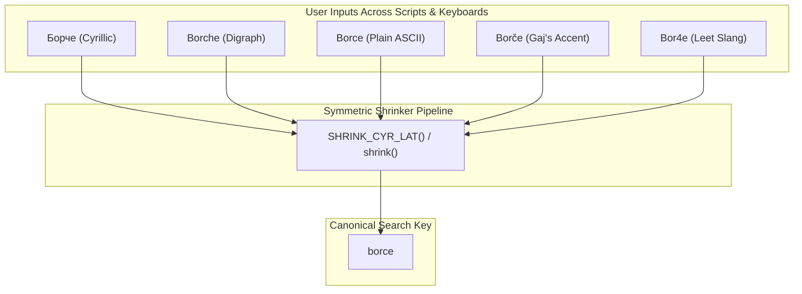
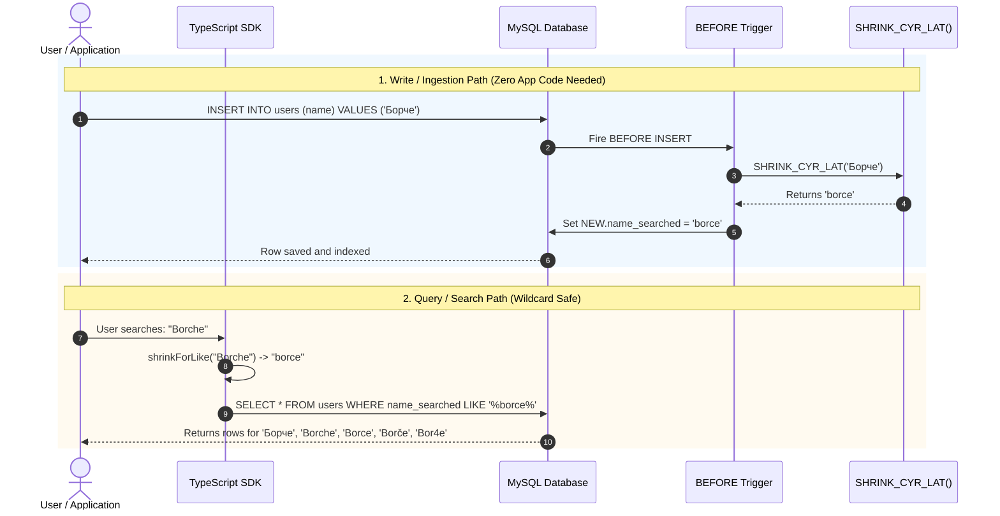

# MySQL Cyrillic & Latin Cross-Script Search

[](file:///home/boris/projects/mysql_cyr_lat_search/tests)
[](file:///home/boris/projects/mysql_cyr_lat_search/tests)
[](file:///home/boris/projects/mysql_cyr_lat_search/package.json)
[](file:///home/boris/projects/mysql_cyr_lat_search/sql)
[](file:///home/boris/projects/mysql_cyr_lat_search/package.json)

> **High-performance cross-script (Cyrillic & Latin) search for MySQL and TypeScript using symmetric base-folding to seamlessly match digraphs, diacritics, and regional Slavic alphabets.**

---

## The Problem: Orthographic Chaos in Slavic Search

In everyday digital communication across South and East Slavic regions (Macedonian, Serbian, Bulgarian, Croatian, Russian, Ukrainian), users type names and text using completely different alphabets and orthographies:

| User Input Type | Example Spelling | What the User Expects |
| :--- | :--- | :--- |
| **Native Cyrillic** | `Борче` | Should find all records regardless of spelling |
| **English Digraphs** | `Borche` | Should match `Борче`, `Borce`, and `Borče` |
| **Plain ASCII** | `Borce` | Should match `Борче`, `Borche`, and `Borče` |
| **Gaj's Latin / Accents** | `Borče` | Should match `Борче`, `Borche`, and `Borce` |
| **SMS / Leet Slang** | `Bor4e` | Should match `Борче`, `Borche`, and `Borce` |

### Why Standard MySQL Collations Fail
Standard MySQL collations like `utf8mb4_unicode_ci` or `utf8mb4_0900_ai_ci` only handle simple case folding and accent stripping. **They cannot equate multi-character digraphs with Cyrillic or Latin letters**:
- `ch` will **never** match `ч` or `c`
- `sh` will **never** match `ш` or `s`
- `zh` will **never** match `ж` or `z`
- `dzh` / `dj` will **never** match `џ` or `ђ`

Traditional one-way transliteration also breaks bidirectional search.

---

## The Solution: Symmetric Charset Shrinking (Base Folding)

Instead of complex phonetics or fragile transliteration trees, **both database records and search queries are symmetrically shrunk to a canonical ASCII base `[a-z0-9]`**:



Any query searching for `"%Борче%"`, `"%Borche%"`, or `"%Bor4e%"` collapses to `"%borce%"`, immediately matching every variation stored in the database.

---

## System Architecture

The project features a **1:1 dual implementation**: a deterministic MySQL stored function and a high-throughput TypeScript engine with exact behavioral parity.



---

## Key Features

- **100% Deterministic & Bidirectional**: Guarantees identical outputs in both TypeScript and MySQL.
- **Ordered Multi-Pass Pipeline**: Multi-character sequences (`shch`, `sht`, `dzh`, `ch`) are processed before single-character letters to prevent collision.
- **Dialect Presets**: First-class handling for regional Slavic variations (`щ`, `ъ`, `я`, `ю`, `ѓ`, `ќ`, `ѕ`, `џ`, `ђ`, `ћ`).
- **Wildcard Injection Safety**: Dedicated functions (`SHRINK_FOR_LIKE` / `shrinkForLike`) escape `%`, `_`, and `\`, avoiding SQL injection or unintended wildcard scans.
- **Zero Overhead Ingestion**: `BEFORE INSERT` and `BEFORE UPDATE` triggers mutate row buffers in memory, skipping external API round-trips.
- **Index Compatible**: Search against standard B-Tree indexes for prefix lookups or N-Gram fulltext indexes for substring matching.

---

## Quick Start

### 1. MySQL Setup

Deploy the stored function and triggers to your database:

```bash
mysql -u root -p your_db < sql/shrink_cyr_lat.sql
mysql -u root -p your_db < sql/triggers.sql
```

Create your table with a search column:

```sql
CREATE TABLE users (
    id BIGINT UNSIGNED AUTO_INCREMENT PRIMARY KEY,
    name VARCHAR(255) NOT NULL,
    email VARCHAR(255) NOT NULL,
    name_searched VARCHAR(255) NOT NULL,
    INDEX idx_name_searched (name_searched),
    FULLTEXT INDEX ft_name_ngram (name_searched) WITH PARSER ngram
) ENGINE=InnoDB DEFAULT CHARSET=utf8mb4 COLLATE=utf8mb4_0900_ai_ci;
```

Now insert rows normally in any script:
```sql
INSERT INTO users (name, email) VALUES 
('Борче', 'borche@example.com'),
('Borče', 'borce.gaj@example.com');
-- name_searched automatically becomes 'borce' via trigger!
```

Search using any alphabet:
```sql
-- Client searches using Latin digraph: "Borche"
SELECT * FROM users 
WHERE name_searched LIKE CONCAT('%', SHRINK_FOR_LIKE('Borche'), '%');
```

---

### 2. TypeScript / Node.js Setup

Install the library:

```bash
npm install mysql-cyr-lat-search
```

#### Basic Normalization
```typescript
import { shrink, matches, contains } from 'mysql-cyr-lat-search';

// Shrink to canonical ASCII key
shrink('Борче');  // 'borce'
shrink('Borche'); // 'borce'
shrink('Borče');  // 'borce'
shrink('Bor4e');  // 'borce'

// Cross-script equivalence check
matches('Борче', 'Borche'); // true
matches('Пешо', 'Pesho');   // true
matches('Жарко', 'Zharko'); // true

// Cross-script substring search
contains('Здраво Борче', 'borche'); // true
```

#### SQL Query Builder (Parameterized & Wildcard Safe)
```typescript
import { buildShrunkLike } from 'mysql-cyr-lat-search';

// Generates { sql: 'name_searched LIKE ?', param: '%borce%' }
const query = buildShrunkLike('name_searched', 'Борче', 'both');

await db.query(`SELECT * FROM users WHERE ${query.sql}`, [query.param]);
```

---

## Wildcard Safety: Storage vs. Query

| Context | Function | Behavior with `%` and `_` | Why? |
| :--- | :--- | :--- | :--- |
| **Storage / Trigger** | `SHRINK_CYR_LAT()` | **Preserves literal `%` and `_`** | A product named `"100% Pure"` must be stored on disk as `"100% pure"`, never corrupted with escape slashes like `"100\% pure"`. |
| **Search Queries** | `SHRINK_FOR_LIKE()` / `shrinkForLike()` | **Escapes `%` → `\%` and `_` → `\_`** | Prevents user-supplied wildcards from matching accidental patterns in SQL `LIKE` queries. |

---

## Documentation Deep Dives

For detailed implementation specifics, consult the documentation guides:

- 📐 [**Architecture & System Design**](file:///home/boris/projects/mysql_cyr_lat_search/docs/architecture.md) — Deep dive into symmetric base-folding, pipeline stages, and design trade-offs.
- 📖 [**Canonical Mapping Rules & Dialects**](file:///home/boris/projects/mysql_cyr_lat_search/docs/mapping-rules.md) — Comprehensive character mapping tables, digraph ordering, and regional Slavic dialect presets.
- 🗄️ [**MySQL & MariaDB Guide**](file:///home/boris/projects/mysql_cyr_lat_search/docs/mysql-guide.md) — Trigger setup, generated columns, N-gram fulltext indexes, and migration scripts.
- 💻 [**TypeScript SDK Guide**](file:///home/boris/projects/mysql_cyr_lat_search/docs/typescript-sdk.md) — `Shrinker` class options, batch processing, and query builder helpers.

---

## Project Structure

```
mysql_cyr_lat_search/
├── docs/
│   ├── architecture.md       # Architecture, flow diagrams & pipeline guarantees
│   ├── mapping-rules.md      # Complete reduction rules & dialect specifications
│   ├── mysql-guide.md        # Database setup, triggers, indexes & queries
│   └── typescript-sdk.md     # TypeScript library API & query builder guide
├── sql/
│   ├── shrink_cyr_lat.sql    # Production SHRINK_CYR_LAT() & SHRINK_FOR_LIKE() functions
│   ├── schema.sql            # Table definitions & N-gram fulltext indexes
│   ├── triggers.sql          # In-memory BEFORE INSERT & BEFORE UPDATE triggers
│   ├── demo.sql              # Interactive verification script
│   └── migrations/           # Reversible versioned migrations (001 - 004)
├── src/
│   ├── index.ts              # Main SDK entry point
│   ├── normalizer/
│   │   ├── rules.ts          # Reduction ruleset definitions & dialect configurations
│   │   ├── rules.json        # Precompiled JSON rules
│   │   └── shrinker.ts       # High-throughput sequential reduction engine
│   ├── query_builder/
│   │   └── index.ts          # Safe LIKE & MATCH AGAINST query builder helpers
│   └── sql/
│       └── migrator.ts       # Migration parser, runner & SQL stored function validator
└── tests/
    ├── shrinker.test.ts      # Unit tests for Shrinker engine (100% coverage)
    ├── sql_migrations.test.ts # Stored function parity & migration lifecycle tests
    └── mysql_search.test.ts  # End-to-end cross-script MySQL LIKE search tests
```

---

## Verification & Testing

The test suite runs with native Node.js type stripping and test runner:

```bash
# Run all tests
npm test

# Run tests with 100% coverage reporting
npm run test:coverage
```

Output:
```
✔ Step 4 Integration Tests: Cross-Script MySQL Search
✔ Standalone Shrinker Library
✔ MySQL SHRINK_CYR_LAT Stored Function & Migrations
ℹ tests 73
ℹ suites 23
ℹ pass 73
ℹ fail 0
```

---

## License

[MIT](file:///home/boris/projects/mysql_cyr_lat_search/package.json) © Boris Barbulovski
