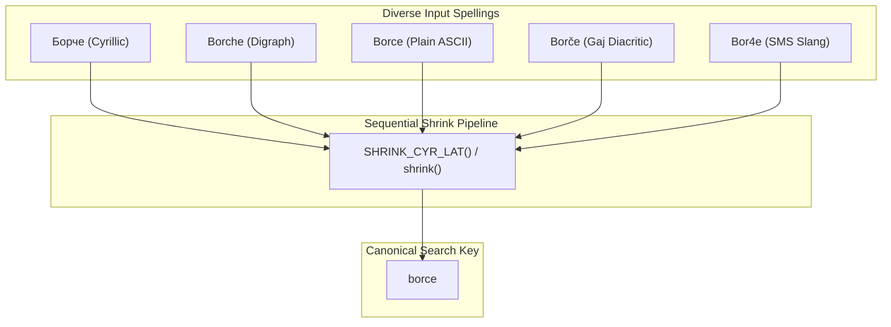
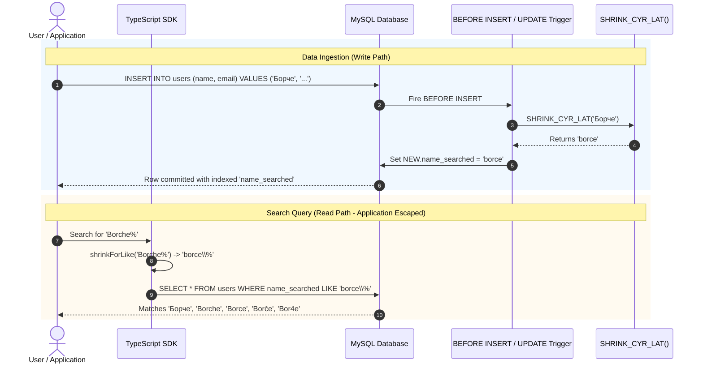
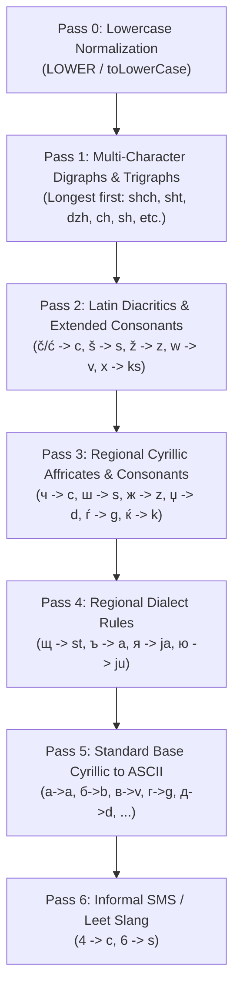

# Architecture & System Design: Symmetric Charset Shrinking

This document outlines the core architecture, design philosophy, sequential pipeline guarantees, and data flows of **`mysql-cyr-lat-search`**.

---

## 1. Core Philosophy: Symmetric Base Folding

When dealing with Slavic languages (Macedonian, Serbian, Bulgarian, Croatian, Russian, Ukrainian, etc.), users routinely switch between:
1. **Native Cyrillic**: `Борче`, `Пешо`, `Жарко`, `Ѓорѓи`, `Поща`
2. **English-style digraphs**: `Borche`, `Pesho`, `Zharko`, `Gjorgji`, `Poshta`
3. **Plain ASCII**: `Borce`, `Peso`, `Zarko`, `Gorgi`, `Posta`
4. **Accented / Gaj's Latin**: `Borče`, `Pešo`, `Žarko`
5. **Leet / SMS Slang**: `Bor4e`, `Pe6o`

Standard database collations (like `utf8mb4_unicode_ci` or `utf8mb4_0900_ai_ci`) only fold case or strip standard accents. They cannot equate multi-character digraphs (`ch`) with Cyrillic letters (`ч`) or single Latin letters (`c`).

### Why Base Folding Beats Transliteration
Traditional approaches attempt full transliteration (e.g. converting all Cyrillic to English transliteration or vice versa). However, standard transliteration fails in bidirectional search:
- If `ч` transliterates to `ch`, a user searching for `Borce` will **fail** to match `Борче`.
- If `c` transliterates to `ц`, a user searching for `Borche` will produce `Борче` while `Borce` produces `Борце`.
- Accents like `č` and `ć` might transliterate to `ch` or `c` inconsistently.

**The Solution: Symmetric Base-Folding (Shrinking)**
Instead of preserving phonetic complexity, **both stored records and search terms are symmetrically collapsed into an ASCII canonical base `[a-z0-9]`**:
- Both `ch` and `ч` shrink to **`c`**.
- Both `sh` and `ш` shrink to **`s`**.
- Both `zh` and `ж` shrink to **`z`**.
- Both `č` and `ć` shrink to **`c`**.
- Digits `4` and `6` fold to **`c`** and **`s`**.

---

## 2. System Architecture & Dual Data Flow

The project provides an identical algorithm implemented in both **MySQL Stored Functions** and a **TypeScript / JavaScript Library**.

### Data Ingestion vs. Query Time Flow

---

## 3. Order-Guaranteed Reduction Pipeline

Transformation rules cannot run arbitrarily. They are applied in strict sequential order to guarantee that multi-character sequences are not broken by partial matches:

### Why Order Matters
1. **Trigraphs before Digraphs**: `shch` must be evaluated before `sh` and `ch`, otherwise `shch` would partially match `sh` -> `s`, leaving `sch` behind.
2. **Latin Digraphs before Single Diacritics**: Sequences like `dž` or `dzh` must be collapsed before standalone `ž` or `z` replacements.
3. **Regional Consonants before Standard Cyrillic**: Complex letters like `щ`, `љ`, `њ` must be resolved before base letters like `с` or `л`.

---

## 4. Wildcard Safety Architecture

A critical design consideration in SQL `LIKE` queries is handling SQL wildcards (`%` and `_`).

### The Storage vs Query Invariant
| Stage | Function | Behavior | Rationale |
| :--- | :--- | :--- | :--- |
| **Storage (Database Trigger)** | `SHRINK_CYR_LAT()` | Preserves `%` and `_` literally without backslashes. | A user row with title `"100% Cotton"` should store `"100% cotton"` on disk, NOT `"100\% cotton"`. Storing backslashes corrupts data and breaks N-gram fulltext indexing. |
| **Query Parameter (Search)** | `SHRINK_FOR_LIKE()` / `shrinkForLike()` | Escapes `%` → `\%`, `_` → `\_`, and `\` → `\\`. | When a user types `100%` into a search box, escaping guarantees that `%` is searched as a literal character rather than matching any arbitrary characters. |

---

## 5. Architectural Comparison

| Dimension | Standard MySQL Collation (`utf8mb4_0900_ai_ci`) | Transliteration Library (e.g. Cyrillic-to-Latin) | Symmetric Base Folding (`mysql-cyr-lat-search`) |
| :--- | :--- | :--- | :--- |
| **Digraph Matching (`ch` = `ч`)** | ❌ Impossible | ⚠️ One-way only | ✅ Full bidirectional equality |
| **Accent Folding (`č` = `c`)** | ⚠️ Partial / language-dependent | ⚠️ Inconsistent | ✅ Symmetrically folded to `c` |
| **SMS/Leet Slang (`4` = `c`)** | ❌ No | ❌ No | ✅ Symmetrically folded |
| **Index Usability** | ✅ B-Tree index | ❌ Requires runtime function | ✅ B-Tree prefix & N-Gram fulltext |
| **Trigger Overhead** | None | High (external API calls) | Negligible (`BEFORE` trigger in-memory) |
| **Parity** | Engine-only | App-only | Exact 1:1 Parity (MySQL & TypeScript) |
